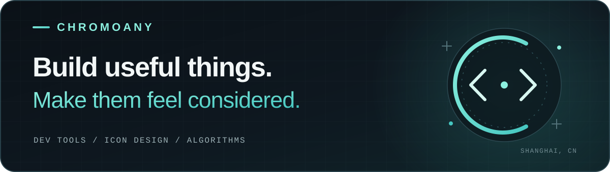

  

## Hi, I'm chromoany.

CS undergraduate at **Shanghai University**. I build tools that solve concrete problems, with a soft spot for offline-first software, thoughtful interfaces, and agent workflows.

上海大学计算机专业在读。写工具，也做图标；在开发项目之外持续训练算法与 ICPC。

[Browse all repositories](https://github.com/chromoany?tab=repositories) · [Selected work](#selected-work)

## Selected work

<table width="100%">
  <tr>
    <td width="50%" valign="top">
      <h3><a href="https://github.com/chromoany/dsh-notify-me">dsh-notify-me</a></h3>
      
System notifications, sound, and tab-title reminders when DSH needs your attention or finishes a reply.

      
<code>JavaScript</code> <code>Agent workflow</code>

    </td>
    <td width="50%" valign="top">
      <h3><a href="https://github.com/chromoany/folio">folio</a></h3>
      
Turn Markdown into book-style PDFs with real tables of contents and page numbers. Fully offline, powered by Pandoc + Typst.

      
<code>Electron</code> <code>Pandoc</code> <code>Typst</code>

    </td>
  </tr>
  <tr>
    <td width="50%" valign="top">
      <h3><a href="https://github.com/chromoany/readme-atlas">readme-atlas</a></h3>
      
An evidence-based agent skill for better project READMEs, distilled from a study of 200 open-source projects.

      
<code>Python</code> <code>Agent skill</code>

    </td>
    <td width="50%" valign="top">
      <h3><a href="https://github.com/chromoany/icpc-regional-template">icpc-regional-template</a></h3>
      
ICPC regional algorithm templates and a trick reference, organized by topic and available as print-ready A4 PDFs.

      
<code>C++</code> <code>Algorithms</code>

    </td>
  </tr>
  <tr>
    <td width="50%" valign="top">
      <h3><a href="https://github.com/chromoany/naiwa-icons">naiwa-icons</a></h3>
      
Soft clay-style Android icons, together with the design specifications and generation prompts behind the artwork.

      
<code>Visual design</code> <code>Android</code>

    </td>
    <td width="50%" valign="top">
      <h3><a href="https://github.com/chromoany/naiwa-icons-app">naiwa-icons-app</a></h3>
      
The companion Android app and release hub for downloading, applying, and exploring Naiwa Icons.

      
<code>Android</code> <code>Icon pack</code>

    </td>
  </tr>
</table>

---

  Useful software. Thoughtful details. No unnecessary noise.  
  <a href="https://github.com/chromoany?tab=repositories">More experiments and works in progress →</a>

